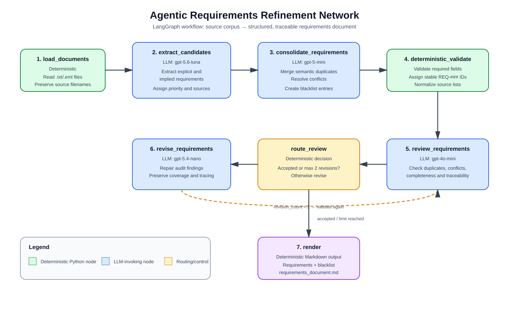

# Agentic requirements refinement network

## Design

`requirements_network.py` accepts one corpus directory and recursively reads `.txt`
and `.eml` files, preserving relative filenames for traceability. The LangGraph
workflow has these nodes:



1. `load_documents` is deterministic and validates that the input is a directory
   containing supported documents.
2. `extract_candidates` uses `gpt-5.6-luna` once per document to capture explicit
   and implied requirements.
3. `consolidate_requirements` uses `gpt-5-mini` to merge semantic duplicates,
   preserve source lists, and normalize terminology.
4. `deterministic_validate` verifies required fields and normalizes stable IDs and
   source ordering.
5. `review_requirements` uses `gpt-4o-mini` to check duplicates, contradictions,
   completeness, explanations, and traceability.
6. `revise_requirements` uses `gpt-5.4-nano` when the review rejects the result.
   The graph loops back through deterministic validation and allows at most two
   revisions before rendering, preventing an unbounded API loop.
7. `render` writes the single structured Markdown document.

This provides four LLM-invoking nodes using four different models, a deterministic
node, and a feedback loop. Pydantic structured output keeps the intermediate data
machine-readable. Requirement IDs are regenerated deterministically after every
revision, and each requirement carries the exact source filenames used for tracing.

## Output behavior

The renderer includes the MoSCoW priority explanation, a paragraph explanation,
stable unique IDs, and a trace list for every requirement. The consolidation and
revision schemas contain a dedicated blacklist with the discarded candidate,
reason, and source list, and the renderer writes it as a separate section. The review prompt checks
completeness, consistency, contradictions, and semantic duplicates; the bounded
revision loop repairs issues when possible.

## Running

Install the dependencies from `requirements.txt`, ensure the provided
`API_key.env` is present beside `requirements_network.py`, and run from the
repository root:

```powershell
pip install -r Week_04_Requirements\Task_1\requirements.txt
python Week_04_Requirements\Task_1\requirements_network.py Week_04_Requirements\Task_1\data\corpus
```

The generated file is `Week_04_Requirements\Task_1\requirements_document.md`.
The script loads credentials from the script directory.
